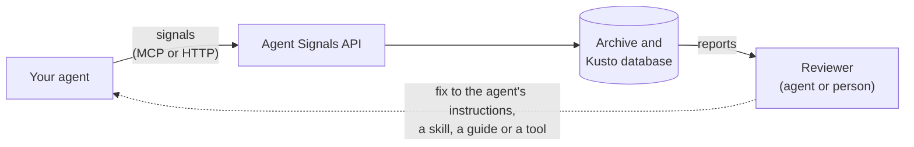

# Agent Signals service

A small service you deploy to your own Azure subscription so your AI agents can tell you how their
work went, and so you can see where they struggle and how far to trust them.

**An example.** An agent finishes a task and reports: "confidence 4 out of 5; the troubleshooting
guide had no step for rolling back a multi-module project." Two other agents report the same gap
that week. The service flags it as a pattern worth fixing. Someone adds the step to the guide, and
the next runs stop reporting it. When a reviewer, a test or a person also grades the work, the
service tells you whether each agent's confidence can be trusted.

The service implements the [Agent Signals protocol](https://github.com/jennyf19/agentic-devops/tree/main/agent-signals),
which defines what agents report. It answers four questions:

- **What keeps going wrong?** Gaps in guides, skills or tools that several runs report.
- **Which skills are struggling?** Low confidence, frequent requests for help, falling confidence.
- **Can we trust what our agents say?** Each agent's confidence compared with an independent grade
  of the same work.
- **Do handoffs between sessions survive?** How ready a handoff was said to be, compared with how
  easily the next session picked it up.

**Status: working prototype.** It runs end to end on a developer machine. It has not yet been
deployed to Azure. [Details](#status).

## Get started

| I want to… | Read |
| --- | --- |
| Understand signals in five minutes | [Signals glossary](docs/glossary.md), first two sections |
| Try it on my machine | [Quick start](#quick-start) below, then [Running locally](docs/local-development.md) |
| Make my agent send signals | [Sending signals](docs/sending-signals.md) |
| Deploy it to my Azure subscription | [Deploying](docs/deploy.md) |
| Read the reports and improve my agents | [Using the reports to improve your agents](docs/improving-agents.md) |
| Understand what happens inside, and what is stored | [How it works](docs/how-it-works.md) |
| Connect ALAS agents | [Accepting ALAS signals](docs/alas-translation.md) |

## Quick start

On a machine with the .NET 10 SDK, the Aspire CLI version 17 preview, PowerShell 7, and Docker
Desktop or Podman running (see [prerequisites](docs/local-development.md#prerequisites)):

```bash
git clone https://github.com/jmprieur/agent-signals-service
cd agent-signals-service
aspire run --apphost src/AgentSignals.AppHost
```

This starts the service with local stand-ins for Azure storage and Kusto; no Azure account is
needed. When it is ready (about a minute after the first download), send the protocol's example
execution and the outcome that grades it as one new run, from another terminal:

```powershell
$run = [guid]::NewGuid()
./samples/Send-Signal.ps1 -ApiUrl http://localhost:5280 -Path ./samples/signals/execution.json -Local -RunId $run -Now
./samples/Send-Signal.ps1 -ApiUrl http://localhost:5280 -Path ./samples/signals/outcome.json -Local -RunId $run -Now
Invoke-RestMethod "http://localhost:5280/v1/insights/overview?days=1"
```

Signals reach the reports a few seconds after they are accepted; if the counts are zero, ask again.
Then let an agent do the same through MCP: see [Running locally](docs/local-development.md#try-it),
which also covers ARM64 machines and what to do if something does not work.

## How it works, in one picture



Agents send signals, usually through the service's MCP server, the way they call any other tool.
The service checks them, keeps every one, and analyses them in Azure Data Explorer (Kusto). Agents
read reports back through MCP too; scripts, pipelines and people can use plain HTTP. The dotted arrow
is the point of the whole exercise, and it is yours: someone reads the reports and changes the agent.
Every Azure resource is declared in code, in [`AppHost.cs`](src/AgentSignals.AppHost/AppHost.cs);
nothing is created by hand.

**Privacy.** The service rejects signals that contain email addresses or secrets, and never stores
who called it, only which application did. It cannot catch everything; agents remain responsible for
what they send. [Details](docs/how-it-works.md#privacy).

## Status

| What | State |
| --- | --- |
| Receiving, checking, archiving and loading signals | Covered by 88 automated tests, and run end to end on Windows x64 against the local storage and Kusto emulators |
| Reports (Kusto queries) | All checked with Microsoft's Kusto language analyzer. `overview`, `skill-health` and `patterns` have answered from the Kusto emulator; the others **have not yet run against a Kusto engine** |
| ALAS conversion | Run over 5,392 real ALAS signals: 96.8% of executions and 98.8% of outcomes conform afterwards ([details](docs/alas-translation.md#results-on-real-alas-signals)) |
| Azure deployment | Deployment templates generate correctly; **not yet deployed**, so Entra ID sign-in and app roles are untested |
| MCP tools | An MCP client listed the tools and called a report against a local run. Submitting signals through MCP is not yet tested |

It builds on preview packages: Aspire 17 daily builds, including Aspire's new Entra ID integration.
Expect to update package versions when Aspire 17 ships.

## Contributing

Build and test from the repository root:

```bash
dotnet build AgentSignals.slnx
dotnet test --solution AgentSignals.slnx
```

[How it works](docs/how-it-works.md#repository-layout) maps the repository.

## License

MIT. The protocol examples in `samples/signals` and `tests/AgentSignals.Tests/Fixtures/spec` come
from the [Agent Signals protocol](https://github.com/jennyf19/agentic-devops/tree/main/agent-signals)
by [jennyf19](https://github.com/jennyf19), also MIT licensed; see [NOTICE](NOTICE).
