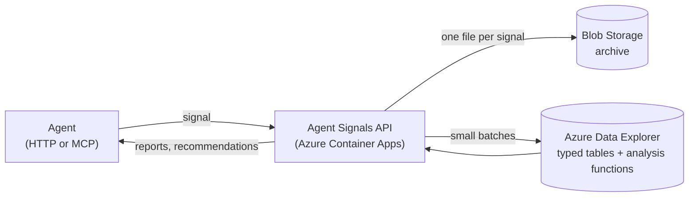

# Agent Signals service

AI agents forget everything between sessions. When an agent finishes a task, the
[Agent Signals protocol](https://github.com/jennyf19/agentic-devops/tree/main/agent-signals) asks it to
leave a short, honest report: how confident it was, what was hard, where the documentation fell
short. A separate evaluator, which can be an agent or a person, later rates the actual result.

This repository is a small service you deploy to **your own Azure subscription** to collect those
signals and turn them into answers:

- **Can we trust what our agents say about their work?** It compares each agent's confidence with the
  independent rating of the same run (the protocol's *trust equation*).
- **Which skills are struggling?** It flags low confidence, frequent escalations, falling confidence,
  and overconfidence, using the protocol's thresholds.
- **What keeps going wrong?** It surfaces documentation and skill gaps that several runs report.
- **Did a handoff between sessions survive?** It compares how ready an agent said its handoff was
  with how easily the next session could pick it up.

Agents send signals over HTTP or through an MCP server, which is also how agents read back
recommendations. It also accepts signals from ALAS, which uses an older format, and converts them
(see [Accepting ALAS signals](docs/alas-translation.md)).

## Status

This is a working prototype, not a hosted product.

| What | State |
| --- | --- |
| Receiving, checking, archiving and loading signals | Built; covered by 88 automated tests that use in-memory stand-ins for storage and Kusto |
| Analysis queries (KQL) | Checked for syntax, unknown columns and type errors with Microsoft's Kusto language analyzer; **not yet run against a Kusto engine** |
| ALAS conversion | Run over 5,392 real ALAS signals: 96.8% of executions and 98.8% of outcomes conform afterwards ([details](docs/alas-translation.md#results-on-real-alas-signals)) |
| Azure deployment | Deployment templates generate correctly; **not yet deployed**, and the full app has not been run locally against working emulators or real resources |
| MCP tools | Built; **not yet exercised by an MCP client** |

It builds on preview packages: Aspire 17 daily builds, including Aspire's new Entra ID integration.
Expect to update package versions when Aspire 17 ships.

## How it works



1. **Check.** Each signal is checked against the protocol's field rules. Signals that contain
   secrets or email addresses are **rejected and not stored**. Signals that break other rules are
   stored with a list of issues but are left out of every score, because the protocol asks to
   capture what happened rather than drop it.
2. **Archive.** The signal is saved as its own file, named by a hash of its content, so a client
   that retries gets a "duplicate" answer instead of a second copy. The archive is the permanent
   record; Kusto can always be rebuilt from it.
3. **Load.** Signals are loaded into Kusto in small batches. Signals that conform also go into
   typed tables (`Executions`, `Outcomes`, `Escalations`, `Partnerships`, `HumanFeedback`); every
   signal goes into `SignalsRaw`. If loading fails, an hourly job reloads anything from the last
   two days that never reached Kusto.
4. **Report.** Kusto functions implement the protocol's formulas. Every report is capped in days and
   rows, following the protocol's rule that agents should read summaries, not the whole history.

All Azure resources are declared in [`AppHost.cs`](src/AgentSignals.AppHost/AppHost.cs): nothing is
created by hand.

## Reports

`GET /v1/insights/{report}?days=7&top=50&skill=<optional>` (role `Signals.Read`). The same reports
are available as MCP tools.

| Report | Answers |
| --- | --- |
| `overview` | How many signals, runs, agents and skills; how many executions no evaluator has rated yet |
| `calibration` | Per agent and skill: 5 minus the gap between confidence and `quality_rating`, plus how much confidence varies (agents can game the score by always answering "3") |
| `model-calibration` | The same, per model that did the work |
| `skill-health` | Skills with low confidence, more than half of runs escalated, falling confidence, or confidence well above the evaluator's rating |
| `patterns` | Gaps reported by several runs, against the protocol thresholds (for example, the same documentation gap in 3 runs). Exact wording only |
| `pattern-evidence` | The raw gap descriptions, for an agent that groups similar wording |
| `recommendations` | Suggestions from agents that review other agents, those confirmed by evaluator ratings first |
| `continuation` | Handoff readiness claimed versus recovery rated by the next session |
| `escalations` | Recent requests for human help |
| `human-feedback` | Optional human ratings, next to the agent's own confidence for the same runs |

## Run it locally

You need the .NET 10 SDK, the [Aspire CLI](https://aspire.dev) (version 17 preview, matching the
packages), and a container runtime such as Docker Desktop or Podman. Storage and Kusto run as local
emulators; no Azure account is needed.

Install the preview CLI with `iex "& { $(irm https://aspire.dev/install.ps1) } -Quality dev"`
(PowerShell) and check that `aspire --version` starts with `17.`. An older CLI cannot drive this
AppHost: `aspire run` hangs on "Connecting to apphost…", and `aspire deploy` fails with "The AppHost
is in publish mode and cannot be started with 'aspire run'".

```bash
aspire run --apphost src/AgentSignals.AppHost
```

**No container runtime, or an ARM64 machine?** The Kusto emulator is published for x64 only. You
can point the local run at a real Kusto database instead, such as Azure Data Explorer's free
cluster, and at a real storage account if needed. See [Running locally](docs/local-development.md).

Locally the API accepts calls from your machine without a token. Send the protocol's example signal:

```powershell
./samples/Send-Signal.ps1 -ApiUrl http://localhost:5280 -Path ./samples/signals/execution.json -Local
```

## Deploy to your subscription

```bash
aspire deploy --apphost src/AgentSignals.AppHost
```

Aspire asks for a subscription, resource group and region, then creates:

| Resource | Purpose |
| --- | --- |
| Azure Container Apps environment, container registry, managed identity | Runs the API with no stored secrets |
| Storage account with a `signals` container | The archive. The API's identity can only read and write blobs |
| Azure Data Explorer cluster and `signals` database | The queryable store. **Dev/Test size** (one node, no SLA, stops when idle); the main running cost. Change the size in `AppHost.cs` for production use |
| Entra ID app registration `agent-signals` | Defines who may call the API: app roles `Signals.Write` and `Signals.Read`, and a `Signals.Access` scope pre-authorized for the Azure CLI |

The account that deploys needs permission to create resources in the subscription **and to create app
registrations** in the subscription's tenant. Some organizations restrict the second; use a tenant
where you are allowed to.

After deploying, assign the app roles: nobody can send or read signals until you do. See
[Who can send and read signals](docs/access.md).

```powershell
./samples/Send-Signal.ps1 -ApiUrl https://<api address> -ApiClientId <agent-signals client id> -Path ./samples/signals/execution.json
```

If the service cannot be reached, the sample keeps the signal in `.signals/`, the protocol's local
fallback, so capturing a signal never blocks the developer.

## Privacy

The protocol forbids code, people's names, email addresses, secrets and repository URLs in signals.
The service enforces part of that at the door:

- **Rejected, not stored:** email addresses, access tokens, GitHub tokens, private keys, cloud access
  keys and connection-string secrets.
- **Stored with a warning:** URLs.
- **Removed:** `pr_url` in ALAS signals.
- **Never stored:** the caller's personal identity. Only the calling application's ID is kept.

This is a safety net, not a guarantee. Agents remain responsible for what they send.

## Repository layout

| Path | Contents |
| --- | --- |
| `src/AgentSignals.Api` | The API: protocol checks, ALAS conversion, archive, Kusto loading, reports, MCP tools |
| `src/AgentSignals.Api/Kusto/schema.kql` | The analysis functions |
| `src/AgentSignals.AppHost` | Every Azure resource, for local runs and deployment |
| `tests/AgentSignals.Tests` | Protocol, conversion, privacy, KQL analysis and endpoint tests |
| `scripts/Grant-SignalsRole.ps1` | Assigns app roles |
| `samples/` | Example signals and a sender with local fallback |

```bash
dotnet build AgentSignals.slnx
dotnet test --solution AgentSignals.slnx
```

## License

MIT. The protocol examples in `samples/signals` and `tests/AgentSignals.Tests/Fixtures/spec` come
from the [Agent Signals protocol](https://github.com/jennyf19/agentic-devops/tree/main/agent-signals)
by [jennyf19](https://github.com/jennyf19), also MIT licensed; see [NOTICE](NOTICE).
