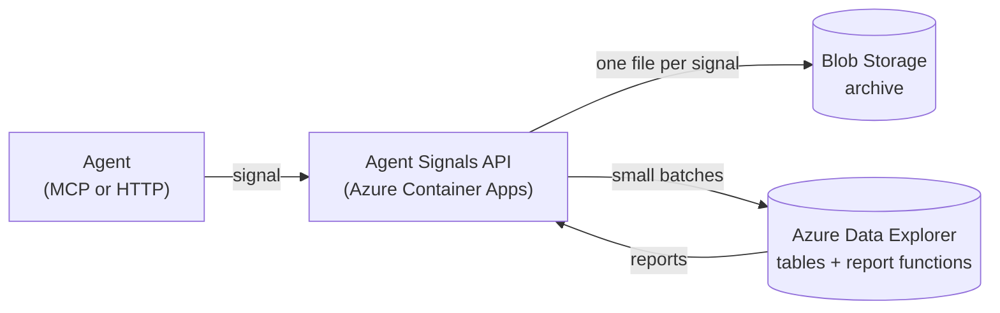

# How it works

What happens to a signal after an agent sends it, what is stored, and where the code lives. You do not
need this page to use the service; it is for people who operate, review or change it.

## The path of a signal

1. **Check.** Each signal is checked against the protocol's field rules. Signals that contain secrets
   or email addresses, are larger than 64 KB, or are not JSON objects are **rejected and not stored**.
   Signals that break other rules are stored with a list of issues but left out of the scores: the
   protocol asks to capture what happened rather than drop it. ALAS signals are
   [converted](alas-translation.md) first.
2. **Archive.** The signal is saved as its own file in Blob Storage, named by a hash of its content,
   so a client that retries gets a "duplicate" answer instead of a second copy. The archive is the
   permanent record; the Kusto database can always be rebuilt from it.
3. **Load.** Signals are loaded into Azure Data Explorer (Kusto) in small batches. Every signal goes
   into the `SignalsRaw` table; conforming ones also go into typed tables (`Executions`, `Outcomes`,
   `Escalations`, `Partnerships`). Human-feedback ratings go into `HumanFeedback` from conforming
   execution signals, and also from ALAS's standalone human-feedback signals, which are stored as
   non-conforming because the protocol does not define that signal type. A non-conforming execution
   contributes no rating. Ratings appear only in the `human-feedback` report, never in calibration. If loading
   fails, an hourly job reloads anything from the last two days that never reached Kusto.
4. **Report.** Kusto functions in [`schema.kql`](../src/AgentSignals.Api/Kusto/schema.kql) implement
   the protocol's formulas. Every report is capped in days (90) and rows, following the protocol's rule
   that agents should read summaries, not the whole history. The service creates or updates the tables
   and functions each time it starts.

Every Azure resource, for local runs and for deployment, is declared in
[`AppHost.cs`](../src/AgentSignals.AppHost/AppHost.cs) with Aspire. Nothing is created by hand.
[Deploying](deploy.md) lists the resources.

## Privacy

The protocol forbids code, people's names, email addresses, secrets and repository URLs in signals.
The service enforces part of that when a signal arrives:

| What | Treatment |
| --- | --- |
| Email addresses, access tokens, GitHub tokens, private keys, cloud access keys, connection-string secrets | **Rejected, not stored.** The answer says which field and what kind of data, never the value |
| URLs | Stored, with a warning |
| `pr_url` in ALAS signals | Removed before storage |
| The caller's personal identity | **Never stored.** Only the calling application's ID is kept, as `submitter` |

This is a safety net, not a guarantee: names or customer details written in prose are not detected.
Agents remain responsible for what they send.

## Sign-in

A deployed service accepts only Microsoft Entra ID tokens for its own app registration, with an app
role: `Signals.Write` to send, `Signals.Read` to read reports. See [Who can send and read signals](access.md).
Local runs accept calls from the same machine without a token; the service refuses that mode outside
the Development environment.

## Repository layout

| Path | Contents |
| --- | --- |
| `src/AgentSignals.Api` | The service: protocol checks, ALAS conversion, archive, Kusto loading, reports, MCP tools |
| `src/AgentSignals.Api/Kusto/schema.kql` | The report functions |
| `src/AgentSignals.AppHost` | Every Azure resource, for local runs and deployment |
| `tests/AgentSignals.Tests` | Protocol, conversion, privacy, Kusto query and endpoint tests |
| `scripts/Grant-SignalsRole.ps1` | Assigns app roles |
| `samples/` | Example signals and a sender that keeps signals locally when the service is down |
| `docs/` | This documentation; start from the [README](../README.md#get-started) |
