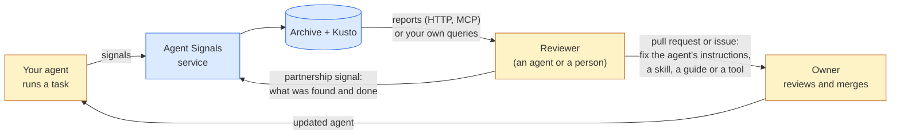

# Using the reports to improve your agents

Signals are worth collecting only if they change something. This page explains how to read the
reports, and how a finding becomes a fix to an agent and a check that the fix worked.

**If you read nothing else**, look at three reports once a week:

1. [`overview`](#overview-is-data-arriving): is data arriving, and how much of it has been graded?
2. [`patterns`](#patterns-problems-that-keep-coming-back): what problem do several runs keep reporting?
   This is where most fixes come from.
3. [`skill-health`](#skill-health-which-skills-need-attention): which kinds of task are struggling?

Once some runs also have [outcomes](glossary.md#outcome-signal), add
[`calibration`](#calibration-how-far-to-trust-an-agents-confidence): how far to trust each agent's
confidence.

Terms such as *execution*, *outcome* and *run* are defined in the [signals glossary](glossary.md).
Every threshold on this page comes from the [Agent Signals protocol](https://github.com/jennyf19/agentic-devops/tree/main/agent-signals)
or from the service's own queries in [`schema.kql`](../src/AgentSignals.Api/Kusto/schema.kql); where
the service adds a rule of its own, the page says so.

## The improvement loop



Blue is what this service provides. Amber is yours: the service collects and analyses signals, but it
does not change your agents.

1. **Your agent reports** after each run. Sometimes an evaluator also grades the run.
2. **The service stores and analyses** the signals.
3. **A reviewer reads the reports** on a schedule. It can be a person, or an agent using the MCP
   tools (the protocol calls it a *consumer*).
4. **The reviewer proposes a fix** as a pull request or issue, and a person merges it. A reviewer
   agent never merges its own changes or edits a production agent directly.
5. **The reviewer records what it did** as a partnership signal, so the next reviewer sees it in
   `recommendations`.
6. **The next runs show whether the fix held.** See [Checking that a fix worked](#checking-that-a-fix-worked).

The protocol's [Closing the loop](https://github.com/jennyf19/agentic-devops/blob/main/agent-signals/closing-the-loop.md)
describes the reviewer in full. This service does not include a reviewer agent yet.

## The reports at a glance

Ask for a report through MCP, by having an agent call the matching tool, or over HTTP with
`GET /v1/insights/{report}?days=7` (role `Signals.Read`). Add `skill` to look at one kind of task;
`overview`, `patterns` and `model-calibration` always cover every skill.

| Report | Answers | MCP tool | Needs outcomes? |
| --- | --- | --- | --- |
| `overview` | How much data is arriving, and how much has been graded | `get_overview` | No |
| `patterns` | Which problems several runs keep reporting | `get_pattern_candidates` | No |
| `pattern-evidence` | The exact wording behind those problems | `get_pattern_evidence` | No |
| `skill-health` | Which kinds of task are struggling | `get_skill_health` | Partly: the overconfidence rule |
| `escalations` | Recent requests for a person | `get_escalations` | No |
| `human-feedback` | Optional ratings people gave when an agent asked them | HTTP only | No |
| `recommendations` | What reviewer agents suggest, outcome-backed suggestions first | `get_recommendations` | No, but they are stronger with |
| `calibration` | How far each agent's confidence matches independent grades | `get_calibration` | **Yes** |
| `model-calibration` | The same, per model that did the work | HTTP only | **Yes** |
| `continuation` | Whether handoffs between sessions held up | `get_continuation_gap` | **Yes**, to verify them |

## Before you read any report

- **Scores run from 1 to 5, and higher is better.** Signals with other values are stored but left out
  of the scores.
- **A report covers a window of days**, 90 at most; 7 by default over HTTP. The protocol suggests 7
  days below 50 signals a week, 3 days for 50 to 500, 24 hours above 500. A longer window means more
  runs, so more rules reach their minimum and more findings appear.
- **Many runs will have no outcome, and that is normal.** The reports marked "No" above work from the
  agents' own signals alone. See [Executions without outcomes](glossary.md#executions-without-outcomes).
- **Runs that send nothing are invisible.** Every rate is a share of runs that sent a signal; an agent
  that crashes before reporting does not lower any score. If you can, count runs from your own logs
  and compare.

## Reports that work from the agents' own signals

### `overview`: is data arriving?

Counts for the window: signals, runs, agents, skills. Check two numbers:

| Field | What to look for |
| --- | --- |
| `conforming_signals` versus `signals` | A gap means senders break field rules. Those signals are kept but not scored |
| `executions_without_outcome` | Runs nobody has graded yet. Normal; but if it is nearly all of them, calibration rests on very few runs |

### `patterns`: problems that keep coming back

Agents name what got in their way in fields such as `tsg_gap` (a troubleshooting guide is missing
something) or `environment_blockers` (a tool or access got in the way). When the same text repeats,
it becomes something to fix.

| Field | Runs in one skill before it counts |
| --- | --- |
| `recurring_pattern` | 2 |
| `tsg_gap`, `skill_gap`, `improvisation`, `environment_blockers` | 3 |
| `what_was_hard` | 5 |

| Status | When | Severity |
| --- | --- | --- |
| Actionable, across skills | Reaches the count in a skill, or appears in 3 or more skills, and spans 3 or more skills | HIGH |
| Actionable | Reaches the count in one skill | MEDIUM |
| Monitoring | One run short of the count | LOW |

Two things to know:

- **Matching is exact** (after lower-casing and trimming punctuation). "Missing step 4" and "step 4 is
  missing" count separately, so the report undercounts. `pattern-evidence` returns the raw wording, so
  an agent or a person can group similar entries.
- **A value seen in 3 skills is actionable even if each skill saw it once.** If agents use short
  codes (for example `access` or `throttled`), a common code reaches this quickly. Check that a code is
  specific enough to act on.

### `skill-health`: which skills need attention

One row per skill (kind of task), with a `severity` of `CRITICAL`, `HIGH` or `OK`. A finding needs at
least 5 runs of that skill in the window, so new or rarely used skills show `OK` until there is enough
evidence.

| Rule | Flagged when | Severity |
| --- | --- | --- |
| Low confidence | 5 or more runs reported confidence 3 or lower | CRITICAL |
| Escalation rate | More than half of the runs asked for a person | CRITICAL |
| Confidence decline | Mean confidence fell by more than 1.0 versus the previous window (both windows need 5 runs) | HIGH |
| Overconfidence (needs outcomes) | Mean confidence is more than 1.0 above the evaluators' mean grade, over 5 or more graded runs | HIGH |

Read `OK` as "no rule fired", not "healthy".

### `escalations`, `human-feedback` and `recommendations`

- `escalations` lists recent requests for a person, newest first, with severity and whether work was
  blocked. A falling escalation rate is good news only if the work is still good.
- `human-feedback` shows ratings people gave when an agent asked them, next to the agent's own
  confidence. Autonomous runs have none, so a low count is expected.
- `recommendations` lists suggestions from reviewer agents (partnership signals). Those backed by
  outcomes come first; treat the others as leads, not facts.

## Reports that need outcomes

### `calibration`: how far to trust an agent's confidence

For each run that has both the agent's signal and an outcome, the protocol's *trust equation*
compares the agent's confidence with the independent grade:

```
calibration = 5 - |confidence - quality_rating|
```

| Mean calibration | Meaning (protocol) |
| --- | --- |
| 5 | The agent knows exactly what it knows |
| 4 | Well calibrated, minor differences |
| 3 | Moderate miscalibration: check which way it misses |
| 2 or lower | Significant miscalibration: adjust the agent or its instructions |

Which way it misses (`mean_delta` is confidence minus the grade):

- **Over-claiming** (`mean_delta` above zero, many `overclaimed_runs`): the agent says its work is
  better than it is. This is the risky direction: people trust results they should have checked.
- **Under-claiming** (`mean_delta` below zero, many `underclaimed_runs`): the agent says its work is
  worse than it is. Safer, but not more honest: honest means the confidence *matches* the grade.
  Steady under-claiming costs people's time (they re-check work that was fine) and can be a form of
  hedging. Treat it as a smaller problem, not a goal.

The `note` column warns when a good score can mislead:

- **Fewer than 5 graded runs:** too little evidence to judge (a service rule).
- **Confidence barely varies** (`confidence_spread` under 0.5): an agent that always answers "3" keeps
  the gap small without being honest. The protocol calls this a known, unsolved weakness.

`model-calibration` compares models: per model that did the work, the number of graded runs, mean
calibration, mean confidence, mean grade and `mean_delta`. It has no `note`, spread or over- and
under-claim counts, so check the number of graded runs yourself before comparing models.

### `continuation`: handoffs between sessions

When one session hands work to another, the first reports how ready the handoff is
(`continuation_readiness`), and the successor or an evaluator reports how well it could resume
(`recovery_rating`, in an outcome). The report shows both, the gap, and how many handoffs lost their
evidence trail or decision boundaries.

Read the gap together with `mean_recovery_rating`: a readiness of 1 and a recovery of 1 give a gap of
zero, yet the handoff failed. `unverified_handoffs` are claims nobody has checked, not evidence that
the handoff worked.

## What the reports cannot tell you

- Whether runs that never sent a signal went well.
- Whether an agent's self-reports are honest, until outcomes arrive.
- Whether two differently worded problems are the same problem.
- Whether a skill is healthy when it has fewer than 5 runs in the window: the `skill-health` rules
  need 5. Patterns, escalations and individual signals are still useful with fewer.

## Acting on a finding

A fix lands wherever the agent gets the knowledge it was missing:

- **The agent's own instructions** (for example `AGENTS.md`, an agent definition, or its system
  prompt), when the problem shows up across many kinds of task: how it should grade itself, when to
  ask a person, which rules always apply.
- **A skill** (for example a `SKILL.md`), when the problem is specific to one kind of task.
- **A troubleshooting guide or other documentation** the agent reads.
- **A tool, access right or service**, when the agent was blocked rather than uninformed.

A finding that appears in several skills often belongs in the agent's instructions. The protocol
suggests a response for each kind of finding:

| Finding | Suggested response |
| --- | --- |
| `tsg_gap` pattern | Pull request that adds the missing step to the troubleshooting guide |
| `improvisation` pattern | Pull request that documents the workaround agents keep inventing, once checked as safe |
| `skill_gap` pattern | Issue describing the case the skill, or the agent's instructions, do not cover |
| `environment_blockers` pattern | Issue for the team that owns the tool, access or service |
| `what_was_hard`, `recurring_pattern` | Mention in the regular report; act only if it points at something specific |
| Skill-health finding | Ask the owner of the skill or agent to review. A score alone does not say what to change |

Keep fixes free of personal data: describe the gap, not the person or customer who hit it.

## Checking that a fix worked

A merged fix is not proof. The protocol treats a problem as resolved only when, after the fix:

1. at least one full window has passed,
2. the skill has had enough new runs to judge (the pattern's run count, or 5 runs for a skill-health
   finding), and
3. the pattern stayed below its count, or the skill-health rule no longer fires.

Compare the same report before and after, with the same window. Rising confidence is encouraging but
not enough: the agent may simply feel surer. Look for the problem disappearing from `patterns` and,
where you have outcomes, for calibration holding.

## Querying Kusto directly

Each report is a Kusto function in the `signals` database, so you can also query, filter and chart
the data yourself in the [Azure Data Explorer web UI](https://dataexplorer.azure.com):

```kusto
// The skill-health report for the last 7 days
SignalSkillHealth(7d)

// The raw wording behind troubleshooting-guide gaps, to group similar entries
SignalPatternEvidence(14d)
| where dimension == "tsg_gap"
| project effective_time, skill_used, value

// Daily confidence for one skill, to see whether a fix moved it
SignalExecutions(30d)
| where skill_used == "<skill>"
| summarize mean_confidence = avg(confidence), runs = dcount(run_id) by bin(effective_time, 1d)
| render timechart
```

Prefer the `Signal…` functions to the tables: they return one row per signal even if a client sent it
twice. The tables and their columns are defined in [`SignalTables.cs`](../src/AgentSignals.Api/Kusto/SignalTables.cs).

After deployment, only the service itself can read the database. To query it, give your account the
**Viewer** role on the `signals` database (Azure portal: the Data Explorer cluster, then Databases,
`signals`, Permissions).
