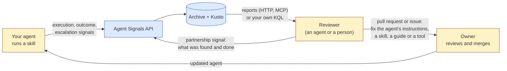

# Using the reports to improve your agents

Signals are worth collecting only if they change something. This page shows how a finding in the
reports becomes a fix to what shapes an agent's behaviour (its own instructions, a skill, a guide or a
tool), and how you check that the fix worked. It
explains what each report's numbers mean, which values the service flags, and what a report cannot
tell you.

Every rule on this page comes from the [Agent Signals protocol](https://github.com/jennyf19/agentic-devops/tree/main/agent-signals)
or from the service's own queries in [`schema.kql`](../src/AgentSignals.Api/Kusto/schema.kql). Where
the service adds a rule of its own, the page says so.

## The improvement loop



Blue is what this service provides. Amber is yours: the service collects and analyses signals, but it
does not change your agents. In words:

1. **Your agent reports** after each run: how sure it was, what was hard, what was missing. An
   evaluator (another agent, a test, a person) grades the same run with an outcome signal.
2. **The service stores and analyses** the signals and answers the reports below.
3. **A reviewer reads the reports** on a schedule. The protocol calls it a *consumer*; it can be an
   agent using the MCP tools, or a person with the HTTP reports or Kusto.
4. **The reviewer proposes a fix** as a pull request or issue, and a person merges it. The protocol
   is explicit: a reviewer agent never merges its own changes or edits a production agent directly.
5. **The reviewer records what it did** as a partnership signal. Those appear in `recommendations`,
   so the next reviewer sees what is already being handled.
6. **The next runs show whether the fix held.** See [Checking that a fix worked](#checking-that-a-fix-worked).

The protocol's [Closing the loop](https://github.com/jennyf19/agentic-devops/blob/main/agent-signals/closing-the-loop.md)
document describes the reviewer in full, including a registry of known patterns. This service does not
include a reviewer agent or a pattern registry yet.

## Before you read any report

- **Scores run from 1 to 5, and higher is better.** 1 is poor, 3 adequate, 5 excellent. Values outside
  1 to 5, or not whole numbers, make a signal non-conforming: it is stored but left out of every score.
- **A report covers a window of days**, 90 at most. Over HTTP the default is 7 (`?days=7`); each MCP
  tool states its own default. The protocol suggests the
  window follow your volume: 7 days below 50 signals a week, 3 days for 50 to 500, 24 hours above 500.
  A longer window gives more runs, so more rules reach their minimum and more findings appear.
- **Self-reports are only half the picture.** An execution signal is the agent's own view. It is
  checked only when an outcome signal for the same `run_id` arrives from someone else: another agent,
  a test result, a person. Without outcomes, calibration and overconfidence stay empty.
- **Runs that send nothing are invisible.** Every rate is a share of runs that sent a signal. An agent
  that crashes before reporting does not lower any score. If you can, count runs from your own logs
  and compare.

## Start with `overview`

Counts for the window: signals, runs, agents, skills, and how many signals were non-conforming or
converted from ALAS. Check two numbers first:

| Field | What to look for |
| --- | --- |
| `conforming_signals` versus `signals` | A gap means senders are breaking field rules. Those signals are kept but not scored |
| `executions_without_outcome` | Runs nobody has graded yet. If this is most of them, calibration rests on a small sample |

## `skill-health`: which skills need attention

One row per skill, with a `severity` of `CRITICAL`, `HIGH` or `OK`. A finding needs at least 5 runs
of that skill in the window, so new or rarely used skills show `OK` until there is enough evidence.

| Rule | Flagged when | Severity |
| --- | --- | --- |
| Low confidence | 5 or more runs reported confidence 3 or lower | CRITICAL |
| Escalation rate | More than half of the runs asked for a person | CRITICAL |
| Confidence decline | Mean confidence fell by more than 1.0 versus the previous window (both windows need 5 runs) | HIGH |
| Overconfidence | Mean confidence is more than 1.0 above the evaluator's mean grade, over 5 or more paired runs | HIGH |

Read `OK` as "no rule fired", not "healthy". A skill with no outcome signals can never be flagged as
overconfident.

## `calibration`: how far to trust an agent's confidence

For each run that has both an execution and an outcome, the protocol's trust equation compares the
agent's confidence with the independent grade:

```
calibration = 5 - |confidence - quality_rating|
```

| Mean calibration | Meaning (protocol) |
| --- | --- |
| 5 | The agent knows exactly what it knows |
| 4 | Well calibrated, minor differences |
| 3 | Moderate miscalibration: check which way it misses |
| 2 or lower | Significant miscalibration: adjust the agent or its instructions |

The report also tells you which way the agent misses:

- `mean_delta` above zero, or many `overclaimed_runs`: the agent claims more than it delivers. This is
  the risky direction.
- `mean_delta` below zero, or many `underclaimed_runs`: the agent is too modest. Usually harmless,
  but it makes the agent's confidence less useful.

The `note` column warns about two cases where a good score can mislead:

- **Fewer than 5 paired runs:** too little evidence to judge (a service rule).
- **Confidence barely varies** (`confidence_spread` under 0.5) **with good calibration:** an agent that
  always answers "3" keeps the gap small without being honest. The protocol calls this a known,
  unsolved weakness of the measure.

`model-calibration` gives the same figures per model, to see whether a model change moved them.

## `patterns`: problems that keep coming back

Agents describe what got in their way in fields such as `tsg_gap` (a troubleshooting guide is
missing something) or `environment_blockers`. When the same value repeats, it becomes something to fix.

| Field | Runs in one skill before it counts |
| --- | --- |
| `recurring_pattern` | 2 |
| `tsg_gap`, `skill_gap`, `improvisation`, `environment_blockers` | 3 |
| `what_was_hard` | 5 |

| Status | When | Severity |
| --- | --- | --- |
| Actionable, across skills | Reaches the count in a skill, or appears in 3 or more skills, and spans 3 or more skills | HIGH |
| Actionable | Reaches the count in one skill | MEDIUM |
| Monitoring | One run short of the count | LOW |

Two things to know:

- **Matching is exact** (after lower-casing and trimming punctuation). "Missing step 4" and "step 4 is
  missing" count separately, so the report undercounts. `pattern-evidence` returns the raw wording, so
  an agent or a person can group similar entries.
- **A value seen in 3 skills is actionable even if each skill saw it once.** If your agents use short
  codes (for example `access` or `throttled`), a common code will reach this quickly. That is often
  right, but check that a code is specific enough to act on.

Short codes from an agreed list group much better than prose, and carry less risk of personal data.

## `continuation`: handoffs between sessions

When one agent or session hands work to another, the first reports `continuation_readiness` and the
successor (or an evaluator) reports `recovery_rating`. The report shows both, the gap between them, and
how many handoffs lost evidence (`material_provenance_loss`) or decision boundaries
(`material_authority_loss`).

Read the gap together with `mean_recovery_rating`. A readiness of 1 and a recovery of 1 give a gap of
zero, yet the handoff failed. `unverified_handoffs` are claims nobody has checked; they are not
evidence that the handoff worked. The service does not grade this report.

## `escalations`, `recommendations` and `human-feedback`

- `escalations` lists recent requests for a person, newest first, with severity and whether work was
  blocked. A falling escalation rate is good news only if outcome grades hold steady.
- `recommendations` lists suggestions from reviewer agents (partnership signals). Those already
  confirmed by outcomes come first.
- `human-feedback` shows optional ratings from people next to the agent's confidence for the same
  runs. Autonomous runs have none, so a low count is expected.

## What the reports cannot tell you

- Whether runs that never sent a signal went well.
- Whether an agent's self-reports are honest, until independent outcomes arrive.
- Whether two differently worded problems are the same problem.
- Anything about a skill with fewer than 5 runs in the window.

## Acting on a finding

A fix lands wherever the agent gets the knowledge it was missing:

- **The agent's own instructions** (for example `AGENTS.md`, an agent definition, or its system
  prompt), when the problem shows up across many tasks: how it should grade itself, when to ask a
  person, which rules always apply.
- **A skill** (for example a `SKILL.md`), when the problem is specific to one kind of task.
- **A troubleshooting guide or other documentation** the agent reads.
- **A tool, access right or service**, when the agent was blocked rather than uninformed.

The `skill_used` field tells you which task a finding came from. A finding that appears in several
skills often belongs in the agent's instructions instead.

The protocol suggests a response for each kind of finding:

| Finding | Suggested response |
| --- | --- |
| `tsg_gap` pattern | Pull request that adds the missing step to the troubleshooting guide |
| `improvisation` pattern | Pull request that documents the workaround agents keep inventing, once checked as safe |
| `skill_gap` pattern | Issue describing the case the skill, or the agent's instructions, do not cover |
| `environment_blockers` pattern | Issue for the team that owns the tool, access or service |
| `what_was_hard`, `recurring_pattern` | Mention in the regular report; act only if it points at something specific |
| Skill-health finding | Ask the owner of the skill or agent to review. A score alone does not say what to change |

Keep fixes free of personal data: describe the gap, not the user or customer who hit it, and do not
copy signal text into a pull request without checking it.

## Checking that a fix worked

A merged fix is not proof. The protocol treats a pattern as resolved only when, after the fix:

1. at least one full window has passed,
2. the skill has had enough new runs to judge (the pattern's run count, or 5 runs for a skill-health
   finding), and
3. the pattern stayed below its count, or the skill-health rule no longer fires.

Compare the same report before and after, with the same window. Rising confidence is encouraging but
not enough on its own: the agent may simply feel surer. Look for the gap disappearing from `patterns`
and, where you have outcomes, for calibration holding.

## Querying Kusto directly

The reports are Kusto functions in the `signals` database, so anything a report shows you can also
query, filter and chart yourself in the [Azure Data Explorer web UI](https://dataexplorer.azure.com):

```kusto
// The skill-health report for the last 7 days
SignalSkillHealth(7d)

// The raw wording behind troubleshooting-guide gaps, to group similar entries
SignalPatternEvidence(14d)
| where dimension == "tsg_gap"
| project effective_time, skill_used, value

// Daily confidence for one skill, to see whether a fix moved it
SignalExecutions(30d)
| where skill_used == "<skill>"
| summarize mean_confidence = avg(confidence), runs = dcount(run_id) by bin(effective_time, 1d)
| render timechart
```

The `Signal…` functions return one row per signal, even if a client sent it twice; prefer them to
reading the tables directly. The tables and their columns are defined in
[`SignalTables.cs`](../src/AgentSignals.Api/Kusto/SignalTables.cs).

After deployment, only the API can read the database. To query it yourself, give your account the
**Viewer** role on the `signals` database (Azure portal: the Data Explorer cluster, then Databases,
`signals`, Permissions).
